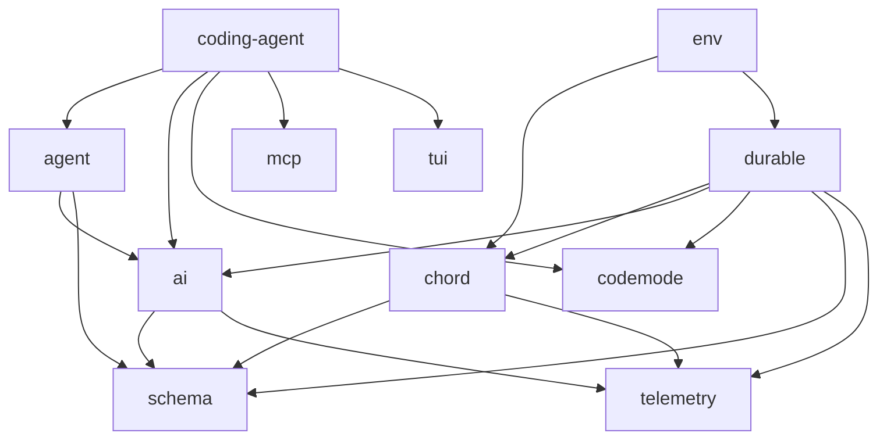

# 实践课2：组织建仓与源码分析 [gufengdi]

## 一、 源码获取

**1. 小组组织仓库**
组长已完成课程仓库的 Fork，仓库归属为小组 Organization（`open-source-slackers`）。
*   **小组代码仓库链接**：`https://github.com/open-source-slackers/pi-hunnu-2026`

**2. 本地源码克隆与验证**
我已在本地执行了以下命令进行克隆：
```powershell
git clone --branch main https://github.com/open-source-slackers/pi-hunnu-2026.git
cd pi-hunnu-2026
```

**3. 仓库信息确认 (截图 S1)**
执行 `Get-Location`, `git remote -v`, `git branch --show-current`, `git rev-parse HEAD`, `git status --short` 的截图如下：


*   **远端地址 (origin)**：`https://github.com/open-source-slackers/pi-hunnu-2026.git` （已确认指向小组组织仓库）
*   **当前分支**：`main`
*   **提交编号 (HEAD)**：`c3cc91632d0a1950fb122605b190233f2aa0006e`

---

## 二、 模块功能分析与构建顺序

**本人重点分析的模块**：`[填写你重点分析的几个模块，例如：schema, agent, coding-agent]`，以下表格由全组共同阅读源码汇总，并由我核对整理。

### 1. 模块分析表

| 子文件夹       | 代码主要实现什么功能                                         | 本模块 build 执行什么、生成什么                            | 直接依赖哪些内部模块                             | 依据文件或代码位置                                |
| -------------- | ------------------------------------------------------------ | ---------------------------------------------------------- | ------------------------------------------------ | ------------------------------------------------- |
| `telemetry`    | 提供供应商中立的遥测契约和类型化 schema 工具。               | 执行 `tsc -p tsconfig.build.json`，生成 `dist` 目录。      | 无                                               | `package.json` 的 `description` 和 `scripts`      |
| `schema`       | 实现 JSON Schema 验证（不依赖 eval，支持 draft 2020-12 和 7）。 | 执行 `tsc -p tsconfig.build.json`，生成 `dist` 目录。      | 无                                               | `package.json` 的 `description` 和 `scripts`      |
| `chord`        | 跨进程应用对象运行时，包含契约、文档、插件热重载、HTTP 和 Web 等。 | 执行 `tsc -p tsconfig.build.json`，生成 `dist` 目录。      | `schema`, `telemetry`                            | `package.json` 的 `description` 和 `dependencies` |
| `tui`          | 提供带有差分渲染的终端用户界面 (TUI) 库，提升文本应用效率。  | 执行 `tsc` 生成 JS；另有原生模块的 `build:native` 脚本。   | 无                                               | `package.json` 的 `description` 和 `scripts`      |
| `codemode`     | 提供沙盒化的 JS 执行环境（唯一能力是调用注入的工具，常用于 AI 代码生成）。 | 执行 `tsc -p tsconfig.build.json`，生成 `dist` 目录。      | 无                                               | `package.json` 的 `description` 和 `scripts`      |
| `mcp`          | 提供独立的模型上下文协议 (Model Context Protocol) 客户端。   | 执行 `tsc -p tsconfig.build.json`，生成 `dist` 目录。      | 无                                               | `package.json` 的 `description` 和 `scripts`      |
| `ai`           | 统一的 LLM API 封装，支持模型自动发现和多供应商（OpenAI/Anthropic等）配置。 | 先执行 `generate-models` 生成模型数据，再执行 `tsc` 编译。 | `schema`, `telemetry`                            | `package.json` 的 `description` 和 `dependencies` |
| `durable`      | 提供持久化的对话、任务和文档运行时环境。                     | 执行 `tsc -p tsconfig.build.json`，生成 `dist` 目录。      | `chord`, `ai`, `codemode`, `schema`, `telemetry` | `package.json` 的 `description` 和 `dependencies` |
| `env`          | 远程执行环境（通过 SSH 部署的小型守护进程及客户端）。        | 执行 `tsc`；另有 `build:daemon` 用于构建 Rust 守护进程。   | `chord`, `durable`                               | `package.json` 的 `description` 和 `dependencies` |
| `agent`        | 提供通用的 Agent 核心逻辑，包括传输抽象、状态管理和附件支持。 | 执行 `tsc -p tsconfig.build.json`，生成 `dist` 目录。      | `ai`, `schema`                                   | `package.json` 的 `description` 和 `dependencies` |
| `coding-agent` | 面向用户的 Coding Agent CLI，包含读/写/编辑工具和会话管理。  | 执行 `tsc` 并打包 bundle，拷贝主题和资源文件。             | `agent`, `ai`, `codemode`, `mcp`, `tui`          | `package.json` 的 `description` 和 `dependencies` |

### 2. 根目录构建顺序
根目录的 `package.json` 中的 `build` 脚本规定了严格的串行构建顺序：
`telemetry` -> `schema` -> `chord` -> `tui` -> `codemode` -> `mcp` -> `ai` -> `durable` -> `env` -> `agent` -> `coding-agent`

---

## 三、 模块依赖关系图及层级划分

箭头方向统一为：**使用方 → 被依赖方**。仅展示有依据的直接内部依赖。



**层级划分依据说明：**
*   **底层（基础层）**：`schema`, `telemetry`, `tui`, `mcp`, `codemode`。它们不依赖其他内部包，提供最基础的数据验证、遥测、界面、协议和执行环境支持。
*   **中下层（通信与对象层）**：`ai`, `chord`。它们依赖底层的 `schema` 和 `telemetry`，封装了大模型接口和跨进程对象运行时。
*   **中上层（能力编排层）**：`agent`, `durable`。`agent` 负责通用的 AI 决策循环；`durable` 整合了大量模块，提供持久化的任务/对话运行能力。
*   **上层（环境与外壳层）**：`env`, `coding-agent`。`env` 提供远程环境支持；`coding-agent` 是最终的 CLI 应用，将所有模块串联起来呈现给用户。

---

## 四、 核心问题解答

**1. 根目录与子模块中的 `npm run build` 分别读取什么配置、执行什么工作？**
*   **根目录**：读取根目录的 `package.json`。它的 `build` 脚本利用了 `workspaces` 特性，通过 `cd` 命令**串行**进入各个子包目录，依次触发子包的 `npm run build`。它起到了统筹构建顺序的作用。
*   **子模块**：读取子模块自身的 `package.json` 和 `tsconfig.build.json`。大部分模块执行 `tsc -p tsconfig.build.json`，将 TS 源码编译为 `dist` 目录下的 JS 和类型声明文件。特殊模块如 `ai` 会先执行生成模型数据的脚本；`coding-agent` 还会执行资源拷贝和 bundle 打包。

**2. 构建顺序和模块依赖有什么关系？相邻构建的模块是否一定互相依赖？**
*   **关系**：构建顺序严格遵循**拓扑排序**。底层依赖包（如 `telemetry`, `schema`）排在最前面，因为它们不需要等其他包编译；上层应用（如 `coding-agent`）排在最后，因为它依赖了 `agent`, `ai` 等。这确保了被依赖的包先构建完成。
*   **相邻是否一定依赖**：**不一定**。例如 `tui` 和 `codemode` 在构建顺序中相邻，但它们互相并不依赖。这种相邻只是因为它们在依赖树中同属底层基础包，或者是为了脚本编写的便利性而排列在一起。

**3. 选择一条涉及至少三个模块的依赖路径，说明这些模块如何分工。**
*   **依赖路径**：`coding-agent` -> `agent` -> `ai` -> `schema`
*   **分工说明**：
    *   `schema`：充当数据地基，负责校验所有输入输出的 JSON 数据结构是否合法。
    *   `ai`：作为通信兵，基于 `schema` 校验过的数据，封装了与各家大模型（OpenAI/Anthropic）通信的 API。
    *   `agent`：作为指挥官，调用 `ai` 向大模型发送请求，并维护智能体的状态（Agent Loop）。
    *   `coding-agent`：作为最终的应用外壳（CLI），调用 `agent` 的核心逻辑，并结合终端界面呈现给用户。

