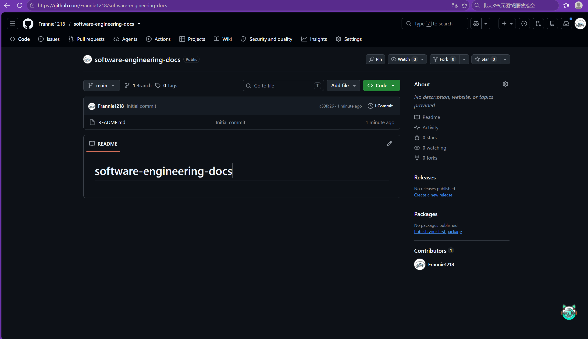
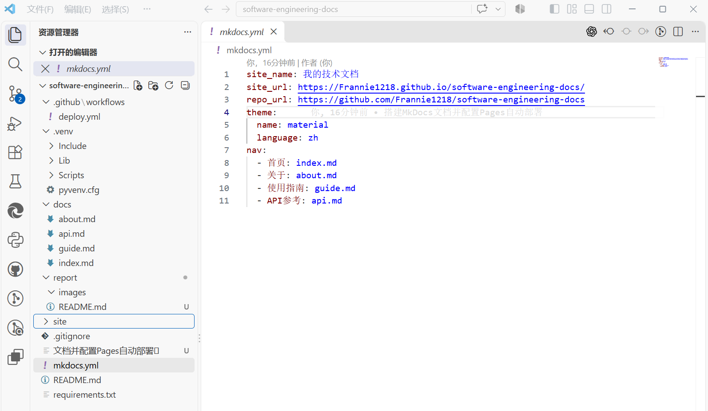
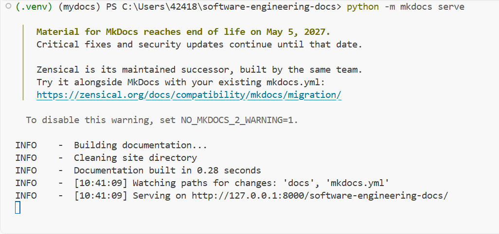
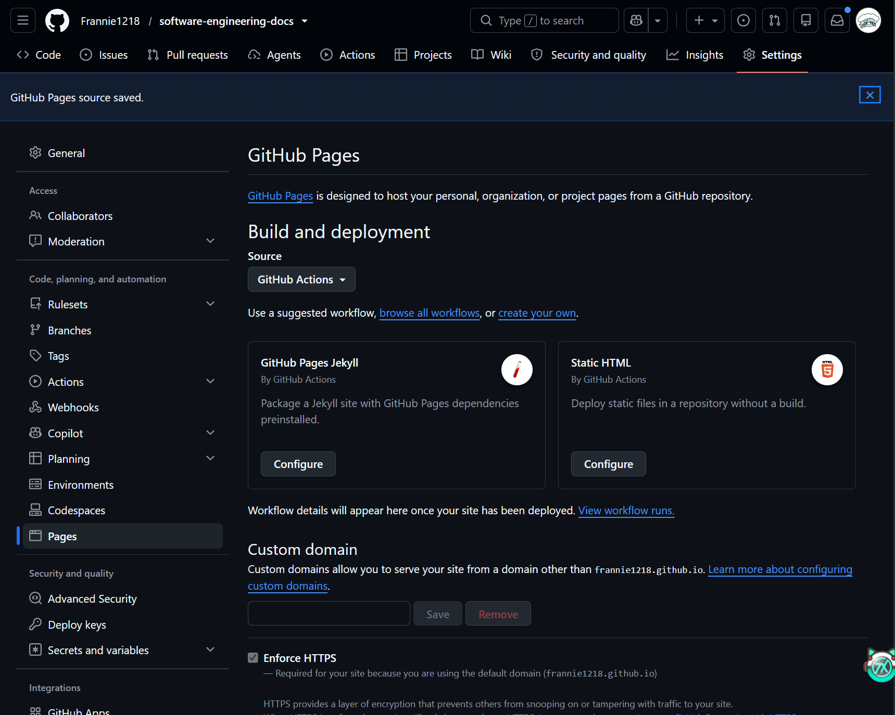
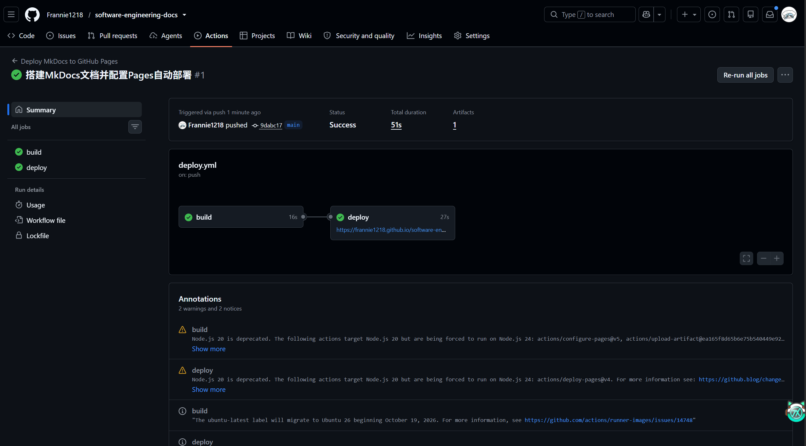
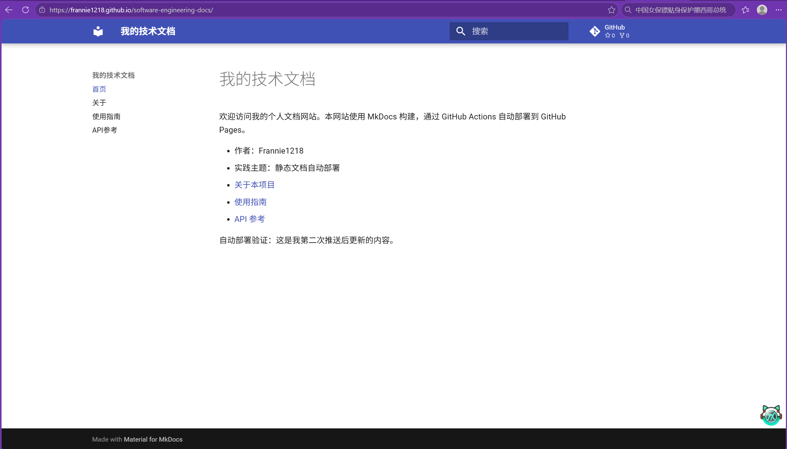
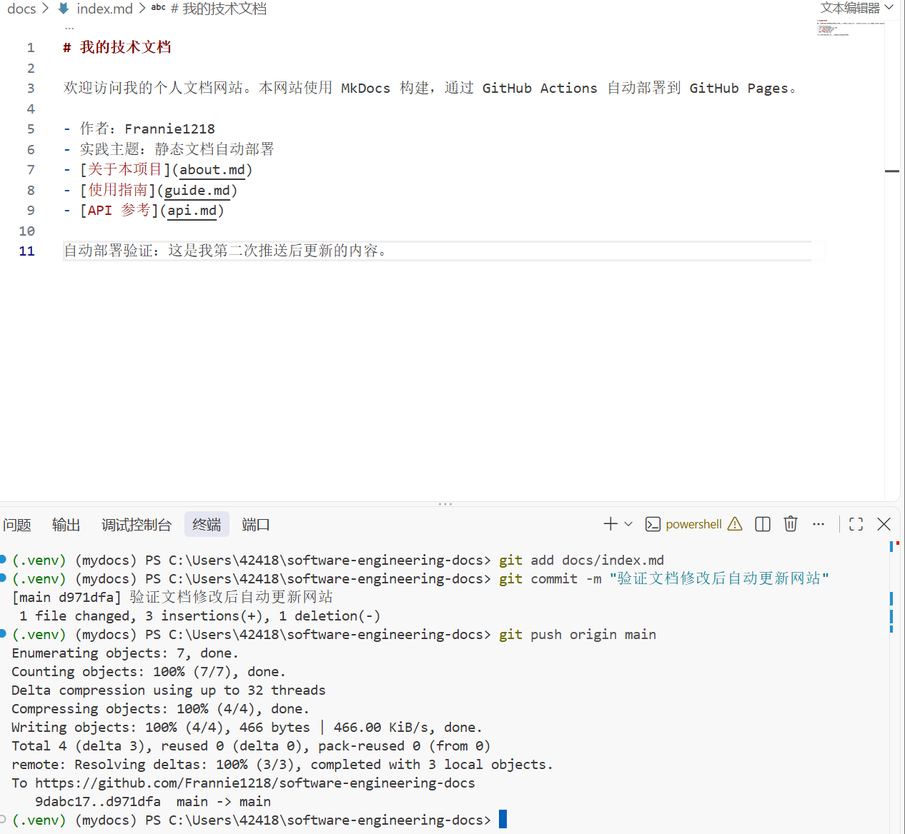
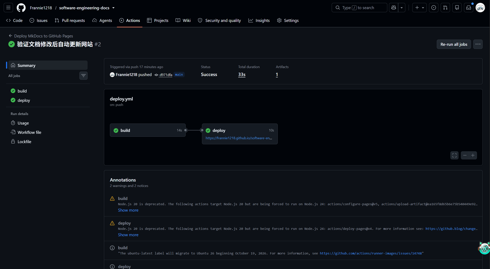

# 实践项目2：个人实验报告

## 1. 基本信息
- **GitHub 登录名**：Fannie1218
- **个人仓库地址**：https://github.com/Fannie1218/software-engineering-docs
- **最终网站地址**：https://fannie1218.github.io/software-engineering-docs/

## 2. 实践过程与关键截图

### 2.1 仓库创建
我登录 GitHub 创建了一个名为 `software-engineering-docs` 的公开仓库。随后在本地克隆了该仓库，并配置了 Git 身份。

### 2.2 项目结构与 MkDocs 配置
我使用 VS Code 建立了文档目录结构。`docs/` 存放 Markdown 源文件，`mkdocs.yml` 用于配置站点信息和导航（nav）。此外还创建了 `requirements.txt` 锁定依赖版本，并在 `.gitignore` 中排除了构建产物 `site/` 和虚拟环境。

### 2.3 本地构建或预览
我在本地使用 Conda 创建了独立的 Python 3.12 虚拟环境，安装了 MkDocs Material 依赖。执行 `mkdocs serve` 后，在浏览器中访问 `http://127.0.0.1:8000/`。我逐一检查了首页、关于、使用指南和 API 参考四个页面，确认了导航栏、表格渲染和代码块均显示正常。

### 2.4 Pages 设置
进入仓库的 Settings -> Pages，将 Build and deployment 的 Source 选项从默认分支切换为了 **GitHub Actions**。这样后续就可以通过官方工作流直接发布静态产物。

### 2.5 Actions 首次构建和部署
推送代码后，我在 Actions 页面观察到工作流自动触发。查看日志发现 `build` 任务成功拉取代码、安装依赖并执行了 `mkdocs build --strict`，随后 `deploy` 任务成功将构建产物发布到 Pages 环境。首次运行圆满成功。

### 2.6 网站访问与四页导航检查
通过 GitHub 提供的地址访问线上网站。我再次对四个页面进行了测试，页面加载迅速，链接跳转正常，样式与本地预览完全一致。

### 2.7 第二次推送与自动更新验证
为了验证自动更新的能力，我在 `docs/index.md` 中增加了一句“自动部署验证：这是我第二次推送后更新的内容。”，然后提交并推送到了 `main` 分支。
- **对应提交/终端记录**：

- **对应 Actions 运行链接**：`【去你 GitHub Actions 页面复制第二次运行的链接粘贴到这里】`
- **效果验证**：等待 Actions 再次变绿后，刷新线上网站，发现新增的文字已经成功生效，且不需要我手动干预任何按钮。

## 3. 问题与解决
在此次实践过程中，主要遇到了以下问题并解决：
1. **终端环境与 Python 版本问题**：一开始系统默认是 Python 3.11，且 PowerShell 存在脚本运行限制。我利用已安装的 Miniconda 创建了 Python 3.12 的纯净虚拟环境（`mydocs`），既统一了与云端 Actions 一致的版本，又避开了脚本限制。
2. **Actions 版本警告**：在首次运行成功后，查看日志底部的 Annotations 发现 Node.js 20 弃用警告（提示 `configure-pages@v5` 和 `deploy-pages@v4` 等）。我确认了流程没有受影响，理解了这是 GitHub 官方 Actions 版本迭代引起的正常提示，当前配置依然能稳定运行。

## 4. 原理理解
**1. docs/ 和 site/ 各保存什么？为什么不用手工修改 site/？**
答：`docs/` 保存的是我手写的 Markdown 源文件，是版本控制的主体；`site/` 是 MkDocs 根据源码和主题自动生成的 HTML/CSS 等静态产物。`site/` 中的内容是由代码计算生成的，如果手工修改，下次重新构建时会被覆盖，而且容易与源码不一致，因此只需修改 `docs/` 即可。

**2. 本次工作流在什么情况下自动运行？**
答：根据 `deploy.yml` 的配置，当 `main` 分支发生 push 操作，且修改的文件涉及 `docs/**`、`mkdocs.yml`、`requirements.txt` 或工作流文件本身时，会自动运行。此外，也可以在 Actions 页面进行手动触发（`workflow_dispatch`）。

**3. build 与 deploy 两个任务有什么区别？**
答：`build` 任务负责“加工”，即拉取代码、安装 Python 环境与依赖、执行 `mkdocs build` 生成网页，最后把产物上传为 Artifact；`deploy` 任务负责“发布”，在 `needs: build` 的前提下，获取刚刚上传的 Artifact，并将其部署到 GitHub Pages 的环境中。两者串行，前者失败则后者不执行。

**4. 只修改 report/README.md 会触发部署吗？为什么？**
答：不会触发。因为工作流配置中的 `paths` 限定了只有代码或文档配置发生变化时才会触发，并未包含 `report/**`。这样设计非常合理，避免了仅修改实验报告（非网站内容）时浪费服务器资源重新构建网站。

**5. 本次方案为何无需创建 gh-pages 分支？**
答：因为本次使用的是 GitHub 官方推荐的 Actions 部署方案（Pages Source 选为 GitHub Actions）。构建产物 `site/` 被作为 Artifact 临时存储，由 `deploy-pages` 直接推送到 GitHub 的后端托管环境，不再需要像老方案那样，强行把产物推送到一个名为 `gh-pages` 的代码分支来触发更新。